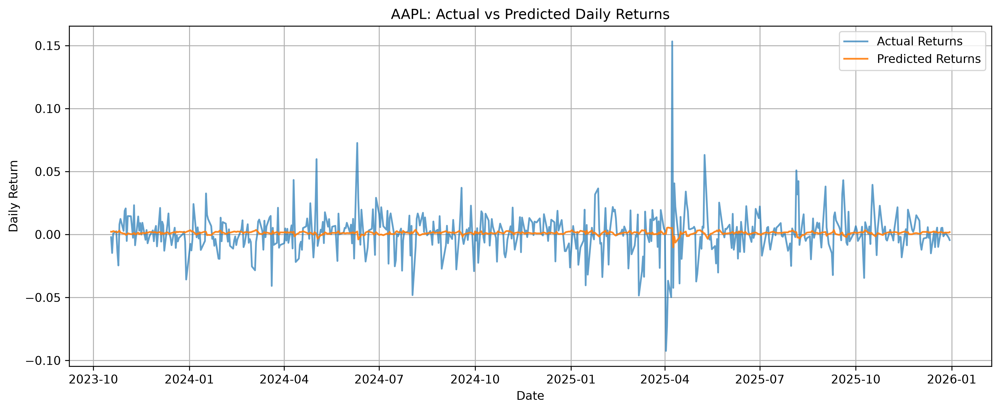
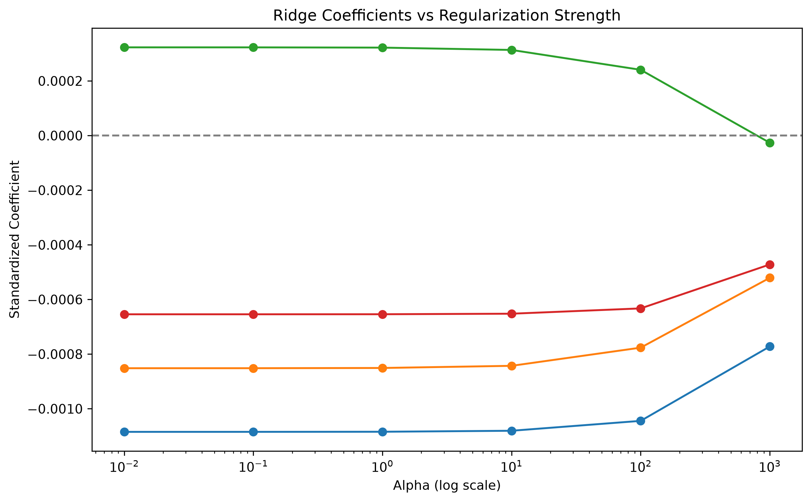
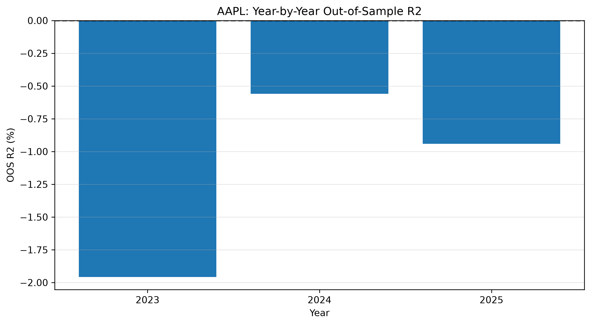
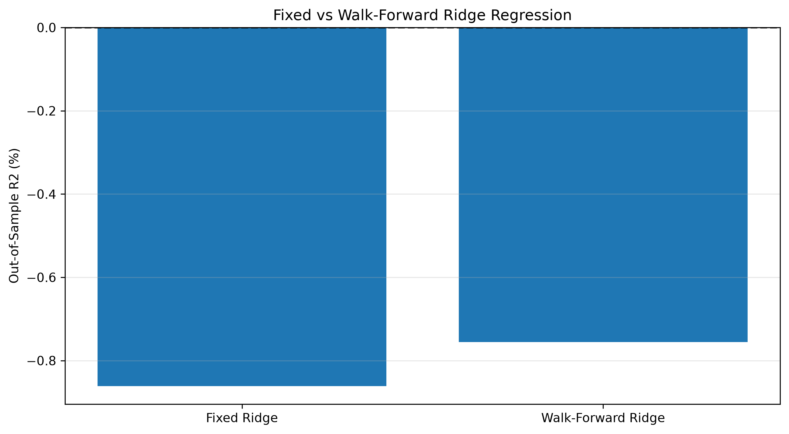

# Stock Return Prediction Using Ridge Regression

A Python project exploring whether historical stock returns can predict next-day Apple (AAPL) stock returns.

## Overview

I used AAPL daily stock data from 2015 to 2025 to build a Ridge regression model.

The model uses four features:
- Daily return
- 3-day average return
- 5-day average return
- 5-day volatility

## Methods

- Ridge Regression
- Time-Series Cross-Validation
- Hyperparameter Tuning
- Coefficient Analysis
- Walk-Forward Testing

## Results

| Model | Out-of-Sample R² |
|---|---:|
| Basic Ridge | -1.78% |
| Tuned Ridge | -0.86% |
| Walk-Forward Ridge | -0.76% |

The models did not outperform a zero-return benchmark, although tuning and walk-forward retraining slightly improved performance.

## Visualisations

**Actual vs Predicted Returns**

**Ridge Coefficients**

**Yearly Performance**

**Walk-Forward Comparison**

## Tools

Python, NumPy, pandas, scikit-learn, Matplotlib, yfinance.

## Conclusion

Historical returns and volatility alone were not sufficient to predict next-day AAPL returns better than a simple benchmark in this experiment.